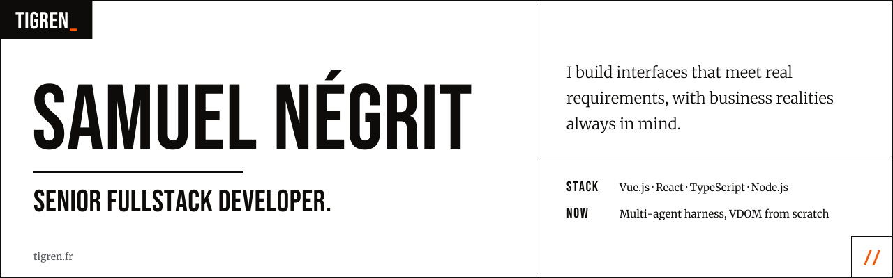

<picture>
  <source media="(prefers-color-scheme: dark)" srcset="./assets/banner-ink.svg">
  
</picture>

Senior fullstack developer. Eight years building web products, mostly Vue and React with TypeScript, Node.js on the back end. Before coding full time, I co-founded two SaaS products and ran a communication studio, so I think in product terms first.

### What I do

- **Front-end architecture** with Vue 3, React and TypeScript, structured around Clean Architecture
- **Migrations and refactoring**: Vue 2 to Vue 3, legacy React codebases, progressive rewrites without freezing delivery
- **Full-stack features** with Node.js and NestJS
- **LLM integration** in existing products

### How I work

- Fast onboarding on existing codebases
- Product mindset from founding and running my own businesses
- Code that the next developer can read without me

### Stack

### Currently

- Building a multi-agent harness to understand how agentic coding tools work under the hood
- Rebuilding a small VDOM and reactivity library from scratch to go deeper on browser fundamentals

### Contact

[tigren.fr](https://tigren.fr) · [LinkedIn](https://www.linkedin.com/in/samuel-negrit) · [Email](mailto:samuel@tigren.fr)
